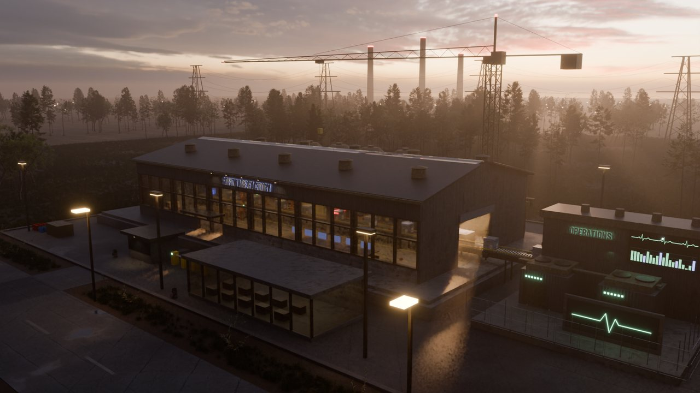
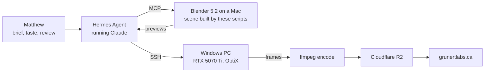
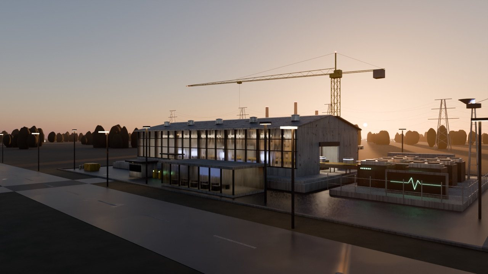
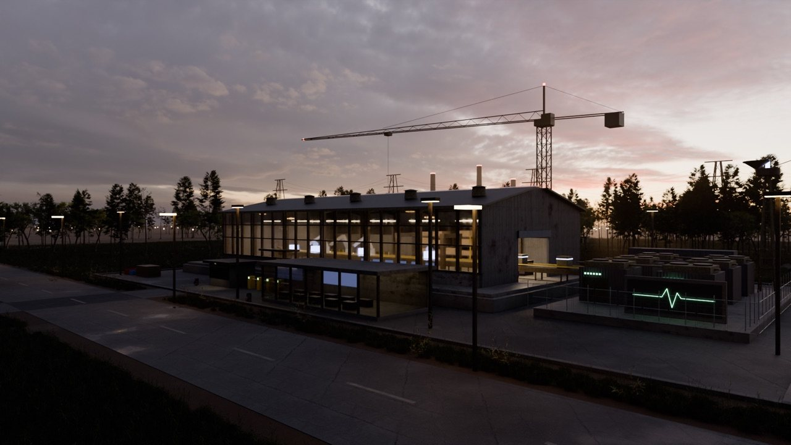
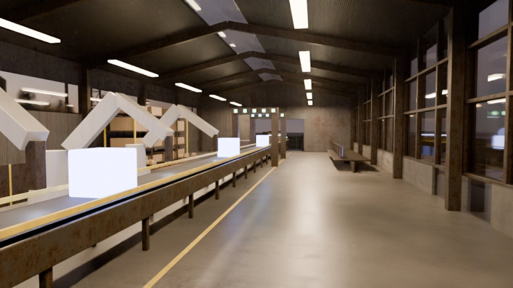
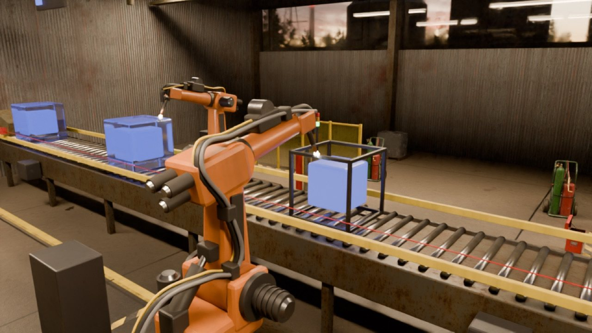
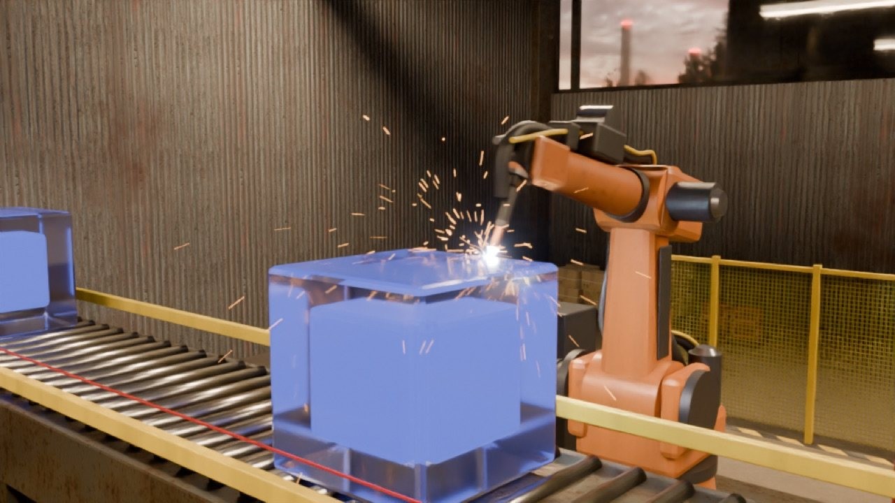
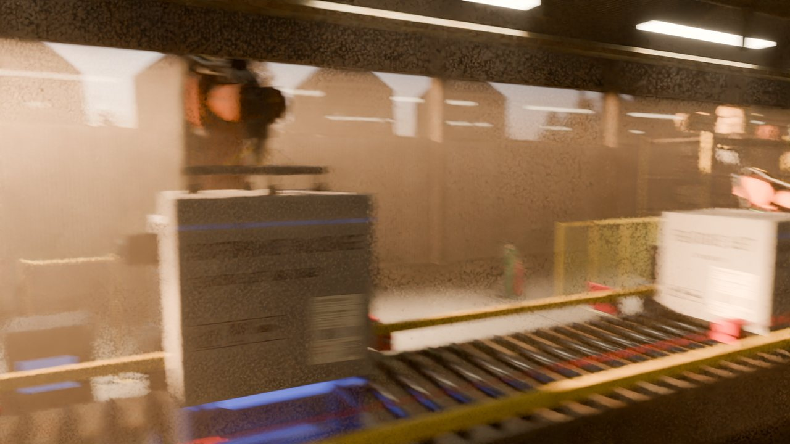
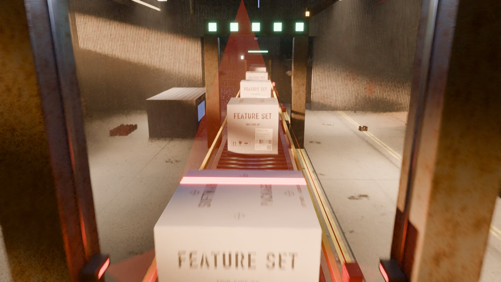

# The Software Factory, rendered

A 36-second cinematic fly-through of a realistic, sunset-lit factory. It is built and rendered entirely from Python scripts by an AI agent driving Blender, under the direction of [Matthew Grunert](https://grunertlabs.ca).

The factory follows the six-stage *Software Factory* figure on [grunertlabs.ca](https://grunertlabs.ca): data foundation, identity platform, people and education, harness and governance, production line, deployed and monitored. Glowing glass "idea" cubes ride in from an intake building through a high-speed roll-up door. A handling robot with a vacuum gripper lowers a labelled steel cover over each one; two welding robots seam-weld the cover to its base tray (sparks, a glowing bead that cools). Two inspection gates laser-scan and photograph each package, a status light turns green, and the line ends in the Operations building, whose LED board shows a live pulse trace and moving bar graphs. The film ends on the "SOFTWARE FACTORY" channel-letter sign and a wide sunset view.



Watch the film: [grunertlabs.ca/projects/software-factory/](https://grunertlabs.ca/projects/software-factory/)

## How it was made

Nobody opened Blender by hand. The work was a conversation:



- **Direction.** Matthew set the brief and the look. He reviewed every preview and pushed back, for example: "the robots are far, far too simplistic".
- **Agent.** [Hermes Agent](https://github.com/NousResearch/hermes-agent) (Nous Research) running Claude (Anthropic) wrote and ran every script in this repo. It drove Blender through Blender Lab's official [MCP server](https://www.blender.org/lab/mcp-server/), and it checked each render with vision before showing it.
- **Rendering.** Previews render on an Apple M4 (Metal). Full-quality frames render on a Windows gaming PC on the same network: the agent set it up over SSH, installed Blender, made the scene portable and drove the renders remotely. A full-quality 1080p frame takes about 3.5 minutes on the Mac and 28 seconds on the PC.

### By the numbers

| | |
|---|---|
| Scene objects | ~6,400, plus ~400,000 grass instances and ~2,400 scanned trees |
| Robots | 3 rigged six-axis arms; joint angles from analytic inverse kinematics, cable packs that follow the arm |
| Film | 864 frames at 24 fps, 1080p, Cycles path tracing with volumetric haze and motion blur; final render 6 h 27 min on one RTX 5070 Ti (about 27 s a frame) |
| Assets | 41 photo-scanned textures, models and one sky from Poly Haven (CC0) |

### The process

| First pass | After review |
|---|---|
|  |  |
| Procedural materials, blob trees, flat ground | Photo-scanned asphalt, concrete, rusted cladding, real trees and grass, an HDRI sunset sky |
|  |  |
| Box "robots", uniform floor and boxes | Rigged welding robots, scanned floor with joints and tyre tracks, varied pallet loads |



| Handling robot lowers a cover | Gate 1 laser scan |
|---|---|
|  |  |

### What went wrong

- **GPU crashes.** Cycles on Metal faulted mid-render. The cause was in the scene, not the driver: spark particles with too little mass and drag reached infinite velocity, and zero-scale objects (used to hide parts) gave singular transforms. The fix: realistic particle mass, a NaN check before every render, and visibility keys instead of zero scale.
- **Paths that worked only on one machine.** macOS opened the project through two different letter cases of the same folder, so Blender wrote broken relative texture paths. They failed only on Windows. The fix: rewrite every asset path from the project root, and run a missing-file check on the render PC.
- **A sun the camera could not use.** At 2 degrees above the horizon, the real sun is behind the tree line. Hidden area lights outside the windows, aimed along the sun's direction, make the shafts of light in the haze (a standard film lighting technique).

## Repository layout

```
factory/build_factory.py   site, buildings, materials, sky, render settings (entry point: build_all)
factory/assets.py          Poly Haven materials (box-projected, no UVs), sky alignment, grass scatter, props
factory/interior.py        robots + IK + cable dress packs, indexed line and cubes, sparks, haze, clutter
factory/camera.py          the fly-through camera (time-parameterised Catmull-Rom through waypoints)
factory/run.py             loads the build script inside Blender
factory/rebuild_cli.py     headless rebuild + particle sanity check + save
factory/render_cli.py      headless still render (OptiX, CUDA or Metal, picked automatically)
factory/anim_cli.py        headless animation render
factory/stills_cli.py      headless review stills at chosen frames (steps the sims through every frame)
factory/textures/          box artwork (stencils, shipping label, barcode, QR), made by tools/make_labels.py
factory/fonts/             Barlow Condensed SemiBold for the signs (SIL Open Font License, OFL.txt)
tools/fetch_assets.py      downloads the Poly Haven assets (~650 MB)
tools/make_labels.py       regenerates the box artwork (needs Pillow, qrcode, python-barcode; macOS fonts)
```

## Build it yourself

Needs [Blender 5.2](https://www.blender.org/download/) and Python 3.

```sh
python3 tools/fetch_assets.py                       # assets -> assets/polyhaven/
blender --python-expr "import bpy; bpy.ops.wm.save_as_mainfile(filepath='factory/software_factory.blend')" -b
blender -b factory/software_factory.blend --python factory/rebuild_cli.py
blender -b factory/software_factory.blend --python factory/camera.py --python-expr "import bpy; bpy.ops.wm.save_mainfile()"
blender -b factory/software_factory.blend --python factory/render_cli.py -- '{"out":"/tmp/frame.png","frame":150,"warm":150,"samples":128,"pct":100,"blur":true}'
```

Particle sparks simulate in frame order, so `warm` steps the scene up to the frame before a single-frame render. Animation renders (`anim_cli.py`) do this by themselves.

## Credits

- 3D assets and sky: [Poly Haven](https://polyhaven.com), CC0. Full list in [CREDITS.md](CREDITS.md).
- [Blender](https://www.blender.org) and Blender Lab's MCP add-on.
- [Hermes Agent](https://github.com/NousResearch/hermes-agent) by Nous Research, running [Claude](https://www.anthropic.com/claude) by Anthropic.

## License

The code in this repository is MIT licensed (see [LICENSE](LICENSE)). Poly Haven assets are CC0 and are not included here; `tools/fetch_assets.py` downloads them.
